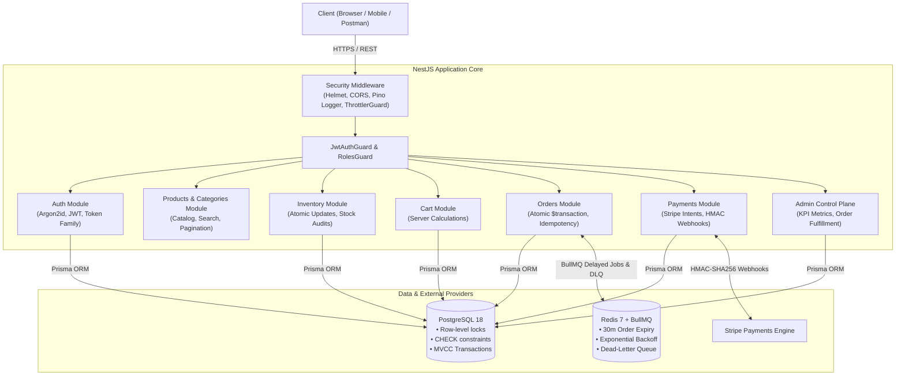
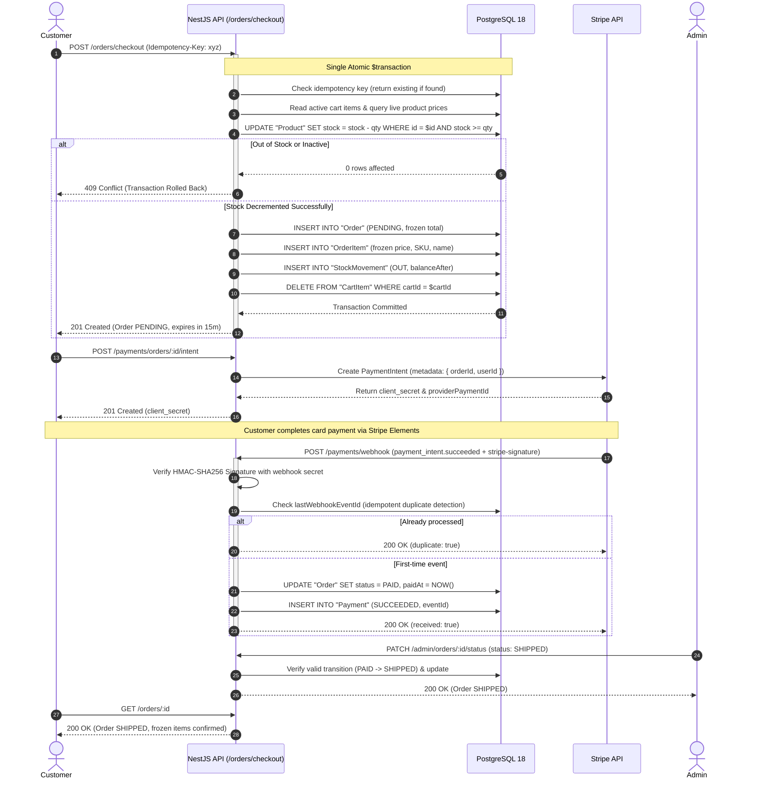
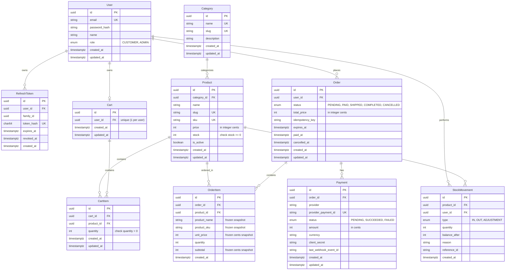

# E-Commerce REST API (NestJS + Prisma + PostgreSQL)

[](https://www.typescriptlang.org/)
[](https://nestjs.com/)
[](https://www.prisma.io/)
[](https://www.postgresql.org/)
[](https://www.docker.com/)
[](.github/workflows/ci.yml)
[](https://e-commerce-nestjs-v1.onrender.com/docs)
[](LICENSE)

A production-grade, modular monolith e-commerce backend built with **strict TypeScript**, **NestJS**, **Prisma ORM**, and **PostgreSQL**.

> 🌐 **Live Demo & API Docs**: **[https://e-commerce-nestjs-v1.onrender.com/docs](https://e-commerce-nestjs-v1.onrender.com/docs)**  
> 🟢 **Health Check**: `https://e-commerce-nestjs-v1.onrender.com/health/live`  
> 👤 **Pre-Seeded Test Credentials**:
> - **Admin:** `admin@example.com` / `Password123!` (Full RBAC write access)
> - **Customer:** `customer@example.com` / `Password123!` (Checkout & order flow)

Designed with strict transactional integrity: atomic inventory decrements, server-side price calculation, frozen order snapshots, idempotency keys, cryptographic Stripe webhook verification, and zero-trust authentication with rotating refresh token families.

> 📖 **Interview Guide**: Check out [`INTERVIEW_PREP.md`](INTERVIEW_PREP.md) for a 3-minute architectural walkthrough, top 8 system design Q&A, and resume bullet points.  
> 🛡️ **Security Policy**: Check out [`SECURITY.md`](SECURITY.md) for our full OWASP API Top 10 checklist, cryptographic standards, and automated regression test report.

---

## Architecture & System Design

### 1. High-Level Modular Monolith Architecture



---

### 2. Atomic Checkout & Payment Concurrency Lifecycle



---

### 3. Database Entity-Relationship Diagram (ERD)



---

## Key Engineering Decisions & Architectural Trade-Offs

| Decision | Approach Chosen | Alternative Rejected | Architectural Justification |
| :--- | :--- | :--- | :--- |
| **Inventory Concurrency** | **Atomic SQL conditional updates** (`WHERE stock >= $2`) | Redis distributed lock (Redlock) | Eliminates external latency hops and split-brain risks; PostgreSQL MVCC row-level locking handles thousands of concurrent checkout operations natively with zero extra infrastructure. |
| **Data Integrity Constraint** | **PostgreSQL `CHECK (stock >= 0)`** | Application-only validation checks | Guarantees that stock can never become negative at the storage layer even in the event of an application logic bug or direct database modification. |
| **Price Calculations** | **Server-side only from live catalog** | Client-submitted subtotals/prices | Prevents price tampering, unauthorized discount injection, or stale pricing bugs. |
| **Historical Invoices** | **Frozen snapshot columns in `OrderItem`** | Foreign-key lookups to `Product` table | Protects accounting integrity: if a merchant renames a product or adjusts prices next year, historical order invoices remain immutable. |
| **Checkout Idempotency** | **Unique `Idempotency-Key` header** | Client-side debouncing only | Guarantees safe network retries; repeated requests return the identical existing order without duplicate charges or duplicate stock decrements. |
| **Webhook Reliability** | **HMAC-SHA256 signature + Event ID tracking** | Unverified webhook endpoints | Protects against payload tampering, forgery, and replay attacks; duplicate webhook deliveries return `200 OK` with `{ duplicate: true }` without mutating state. |
| **Authentication & Tokens** | **Argon2id + Token Family Rotation (SHA-256)** | Stateless JWTs or simple bcrypt | Argon2id provides memory-hardness against GPU cracking; rotating token families detect stolen tokens and instantly revoke the entire compromised session. |
| **Mass Assignment** | **Global `ValidationPipe` with `forbidNonWhitelisted`** | Manual controller picking | Automatically rejects extra or unexpected properties (e.g. `{ role: "ADMIN" }`), preventing privilege escalation attempts. |
| **Async Order Expiration** | **BullMQ + Redis delayed jobs with DLQ & idempotent `$transaction`** | Naive in-process `setInterval` only | Survives process restarts, retries transient failures with exponential backoff (`1s -> 2s -> 4s`), routes exhausted jobs to a Dead-Letter Queue (`order-expiration-dlq`), rolls back cleanly if killed mid-job, and guarantees running the same job twice changes nothing. |

---

## Quickstart

Run the entire application and database locally in 3 commands:

```bash
# 1. Clone repository and install dependencies
git clone https://github.com/baobacluc3/e-commerce-nestjs-v1.git
cd e-commerce-nestjs-v1
npm install

# 2. Setup environment variables
cp .env.example .env

# 3. Start database and API with Docker Compose
docker compose up -d --build
```

The API will be live at `http://localhost:3000/api/v1` and interactive Swagger documentation at `http://localhost:3000/docs`.

---

## Local Development (Without Docker for API)

```bash
# Start PostgreSQL database
docker compose up -d postgres

# Push migrations & generate client
npm run prisma:generate

# Seed sample data (admin user, categories, products with inventory)
npm run db:seed

# Start development server
npm run start:dev
```

### Default Seed Credentials
* **Admin**: `admin@example.com` / `Password123!`
* **Customer**: `customer@example.com` / `Password123!`

---

## API Documentation (Swagger)

Interactive Swagger UI documentation is available at:
`http://localhost:3000/docs`

### Core Endpoints Overview

| Module | Method | Endpoint | Access | Description |
| :--- | :--- | :--- | :--- | :--- |
| **Auth** | `POST` | `/api/v1/auth/register` | Public | Register new customer |
| | `POST` | `/api/v1/auth/login` | Public | Authenticate & receive tokens |
| | `POST` | `/api/v1/auth/refresh` | Public | Rotate refresh token family |
| | `POST` | `/api/v1/auth/logout` | Public | Invalidate refresh token |
| | `POST` | `/api/v1/auth/logout-all` | Customer / Admin | Invalidate all user sessions |
| **Users** | `GET` | `/api/v1/users/me` | Customer / Admin | Get profile info |
| **Products** | `GET` | `/api/v1/products` | Public | Paginated catalog with search/filter |
| | `GET` | `/api/v1/products/:id` | Public | Get product details |
| | `POST` | `/api/v1/products` | Admin | Create product with initial stock |
| | `PATCH` | `/api/v1/products/:id` | Admin | Update product metadata |
| | `DELETE` | `/api/v1/products/:id` | Admin | Soft-deactivate product |
| **Inventory**| `GET` | `/api/v1/inventory/products/:id/stock` | Public | Check stock availability |
| | `POST` | `/api/v1/inventory/products/:id/decrement` | Customer / Admin | Atomically decrement stock |
| | `POST` | `/api/v1/inventory/products/:id/restock` | Admin | Atomically restock product |
| | `POST` | `/api/v1/inventory/products/:id/adjust` | Admin | Adjust stock following cycle audit |
| | `GET` | `/api/v1/inventory/low-stock` | Admin | List products below threshold |
| | `GET` | `/api/v1/inventory/movements` | Admin | Complete movement audit log |
| **Cart** | `GET` | `/api/v1/cart` | Customer / Admin | Get cart with server-calculated total |
| | `POST` | `/api/v1/cart/items` | Customer / Admin | Add item or increment quantity |
| | `PATCH` | `/api/v1/cart/items/:id` | Customer / Admin | Update item quantity |
| | `DELETE`| `/api/v1/cart/items/:id` | Customer / Admin | Remove item from cart |
| | `DELETE`| `/api/v1/cart` | Customer / Admin | Clear all cart items |
| **Orders** | `POST` | `/api/v1/orders/checkout` | Customer / Admin | Atomic checkout with idempotency |
| | `GET` | `/api/v1/orders` | Customer / Admin | User order history |
| | `GET` | `/api/v1/orders/:id` | Owner / Admin | Order details & price snapshots |
| | `POST` | `/api/v1/orders/:id/cancel` | Owner / Admin | Cancel order and restock inventory |
| | `POST` | `/api/v1/orders/expire-unpaid` | Admin | Automated worker: restock expired orders |
| | `GET` | `/api/v1/orders/queues/dlq` | Admin | Inspect Dead-Letter Queue (`order-expiration-dlq`) |
| | `POST` | `/api/v1/orders/queues/dlq/:dlqJobId/retry` | Admin | Replay a dead-letter expiration job |
| **Payments** | `POST` | `/api/v1/payments/orders/:orderId/intent` | Owner / Admin | Create or reuse Stripe PaymentIntent |
| | `GET` | `/api/v1/payments/orders/:orderId` | Owner / Admin | Payment attempts for order |
| | `POST` | `/api/v1/payments/webhook` | Public (Signed) | Idempotent Stripe webhook receiver |
| **Admin** | `GET` | `/api/v1/admin/metrics` | Admin | Real-time dashboard KPI metrics |
| | `GET` | `/api/v1/admin/orders` | Admin | Cross-user order list with filters |
| | `GET` | `/api/v1/admin/orders/:id` | Admin | Full order inspection + items + payments |
| | `PATCH` | `/api/v1/admin/orders/:id/status` | Admin | State transition with cancel restock |
| | `POST` | `/api/v1/admin/inventory/adjust` | Admin | Cycle count manual stock adjustment |
| | `GET` | `/api/v1/admin/inventory/low-stock` | Admin | Products at/below stock threshold |
| | `GET` | `/api/v1/admin/inventory/movements` | Admin | Complete stock audit trail |

---

## Testing & Code Quality

```bash
# Run unit & concurrency test suites (92 tests)
npm test

# Run end-to-end happy-path lifecycle journey test (Phase 10)
# and automated OWASP API Top 10 security regression suite (Phase 9)
npm run test:e2e

# Run test coverage analysis (75%+ statement coverage)
npm run test:cov

# Run ESLint validation (0 errors)
npm run lint

# Format code with Prettier
npm run format

# Production build check
npm run build
```

---

## License

This project is open-source under the [MIT License](LICENSE).
